<h1 align="center">
     你好！
     我是Pet Max 💻
</h1>

  

---

  

---

### 🐷 [每日名言](quotations.md)

<!-- DAILY-QUOTE:START -->

<kbd>2026-10-24</kbd>

- 不积跬步，无以至千里；不积小流，无以成江海。—— 荀子《劝学》
<!-- DAILY-QUOTE:END -->
